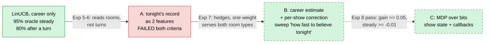
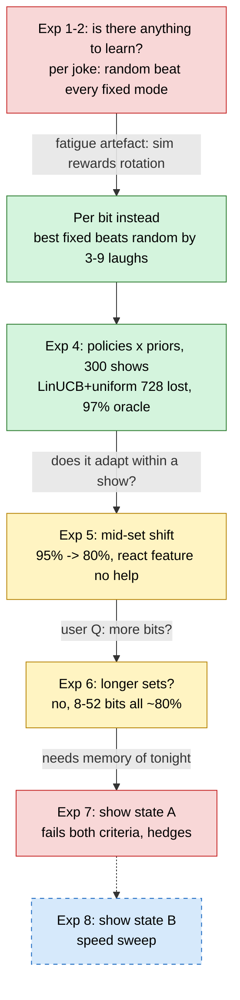
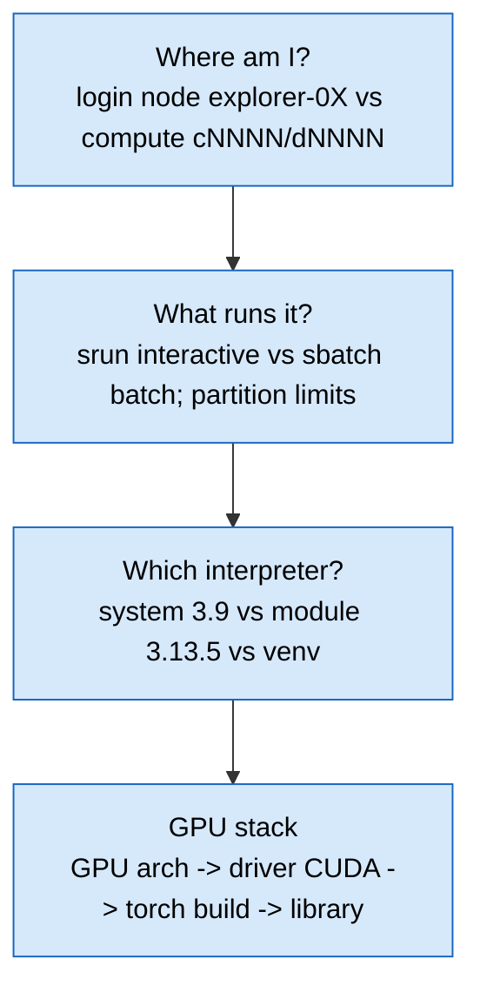

# Study guide: humor-me from first principles to expert

**What this is:** one dense page to get from "I built it" to "I can defend every choice in it".
It condenses the repo's docs (decisions, metrics, dev-log, wiki) into a learning path and points
to them for depth. **Snapshot: 2026-10-31.** Source of truth for current state is
[status.md](status.md); if they disagree, status.md wins.

## How to use this page

Each RL topic is written in four layers. Read top to bottom the first time; later, jump to the
layer you need.

| Layer | Question it answers | Level |
|---|---|---|
| **Intuition** | What's the idea in one picture? | Intermediate |
| **Mechanism** | What does the math/code actually do? | Intermediate → advanced |
| **In this repo** | Where does it live, what did we measure? | Advanced |
| **Expert edge** | Where does it break, what would a reviewer ask? | Expert |

Sections:
1. [Architecture: done vs to do](#1-architecture-done-vs-to-do)
2. [RL concept ladder](#2-rl-concept-ladder): foundations first, Silver-course order (agent/environment → state/Markov → MDP/Bellman → solving → bandits), then LinUCB/TS → priors → non-stationarity → back to MDPs
3. [Experiments: the chain of evidence](#3-experiments-the-chain-of-evidence)
4. [Decision digest](#4-decision-digest) (design + debugging decisions, D-xx style)
5. [Explorer HPC: how we got one job to run](#5-explorer-hpc-how-we-got-one-job-to-run)
6. [Command reference](#6-command-reference)
7. [Resources by level](#7-resources-by-level)
8. [Self-test: interview questions](#8-self-test-interview-questions)

---

## 1. Architecture: done vs to do

Legend: **solid box = built**, **dashed box = not started / in progress**, dashed arrow = planned
data flow. Colours: green = RL/decision, purple = models/LLM, yellow = data, blue = infra/jobs,
pink = UI/audio I/O.

```mermaid
%%{init: {"theme": "default"}}%%
flowchart LR
    subgraph LAPTOP["Laptop (RTX 4060): offline"]
        RJ["rJokes prep R1<br/>403k jokes, pct per year"]:::dataDone
        AUD["sim/audience.yaml<br/>room's hidden truth"]:::dataDone
        ENV["sim/env.py<br/>8 bits x 5 jokes, 0-3 laughs"]:::rlDone
        POL["sim/policies.py<br/>fixed, random, eps-greedy,<br/>LinUCB, LinTS"]:::rlDone
        NB["notebooks/decisions.ipynb<br/>Exp 1-7, 24/24 checks"]:::infraDone
        SSB["Show state B<br/>two timescales"]:::rlTodo
        SSC["Show state C<br/>MDP + callbacks"]:::rlTodo
        PIPE["Transcript pipeline S0-S6<br/>paused, bits F1 0.80"]:::dataDone
        PRIOR["rJokes-derived base<br/>+ human vs judge ranking"]:::dataTodo
    end

    subgraph EXPLORER["Explorer HPC (V100, Slurm)"]
        LAB["label_modes.py<br/>Qwen2.5-7B, fp16<br/>R2 running"]:::infraTodo
        MODES["modes.jsonl<br/>ids + mode + safety"]:::dataTodo
    end

    subgraph LIVE["Live demo (browser + FastAPI): weeks 3-5"]
        MIC["mic -> VAD"]:::uiTodo
        LAUGH["laughter detector<br/>+ operator button"]:::uiTodo
        ASR["ASR -> banter/roast"]:::uiTodo
        DIR["Director<br/>LinUCB per bit"]:::rlTodo
        GEN["Bit writer<br/>identity x mode, K candidates"]:::modelTodo
        SAFE["safety filter<br/>teens = strict"]:::modelTodo
        TTS["TTS -> waveform UI"]:::uiTodo
        LOG["episode log"]:::dataTodo
    end

    subgraph API["External API"]
        GEM["Gemini flash-lite<br/>TTFT ~0.6 s measured"]:::modelDone
    end

    RJ -->|"30k sample"| LAB
    LAB --> MODES
    MODES -.->|"per-mode percentiles"| PRIOR
    PRIOR -.->|"replaces base"| AUD
    AUD --> ENV
    ENV -->|"reward = level/3"| POL
    POL -->|"run() + cache"| NB
    POL -.-> SSB -.-> SSC
    PIPE -.->|"aggregate structure stats"| GEN
    POL -.->|"same policy, live"| DIR
    MIC -.-> LAUGH -.->|"reward"| DIR
    MIC -.-> ASR -.-> DIR
    DIR -.->|"mode"| GEN
    GEN -.-> GEM
    GEN -.-> SAFE -.-> TTS
    DIR -.-> LOG

    classDef rlDone fill:#d4f4dd,stroke:#2e7d32,color:#000
    classDef rlTodo fill:#d4f4dd,stroke:#2e7d32,stroke-dasharray:5 5,color:#000
    classDef modelDone fill:#e8dcf8,stroke:#6a1b9a,color:#000
    classDef modelTodo fill:#e8dcf8,stroke:#6a1b9a,stroke-dasharray:5 5,color:#000
    classDef dataDone fill:#fff4c2,stroke:#b8860b,color:#000
    classDef dataTodo fill:#fff4c2,stroke:#b8860b,stroke-dasharray:5 5,color:#000
    classDef infraDone fill:#d6e9fb,stroke:#1565c0,color:#000
    classDef infraTodo fill:#d6e9fb,stroke:#1565c0,stroke-dasharray:5 5,color:#000
    classDef uiTodo fill:#fbdce8,stroke:#ad1457,stroke-dasharray:5 5,color:#000
```



**Why this shape** (the three load-bearing choices):
- **RL is proven in simulation, shown live.** The grade can't depend on a noisy mic in a classroom.
  The sim answers "does the algorithm adapt?"; it cannot answer "are the jokes funny?".
- **Explorer is optional infrastructure.** Nothing on the laptop waits for it: the sim runs on
  placeholder priors until `modes.jsonl` arrives.
- **Hierarchy of decisions:** set planner (before show) → director (per bit, the RL part) → bit
  writer (per beat). Length and coherence come from the plan, not from tokens.

### Show-state ladder (the open research thread)



---

## 2. RL concept ladder

Taught in the order of David Silver's UCL course: what RL is → states and the Markov property →
MDPs and Bellman equations → how they're solved → exploration (bandits) as the special case where
there's only one state. Our project lives in that last case and keeps being pushed back up the
ladder. Each foundation ends with **"In the stand-up agent"** so the abstraction lands on
something concrete, and a **check** question to answer before moving on.

| Part | Silver lecture | This guide |
|---|---|---|
| What RL is, agent/environment, state | L1 Introduction | F1–F4 |
| MDPs, return, value, Bellman | L2 Markov Decision Processes | F5–F6 |
| Solving with a model / without one | L3 DP, L4–5 model-free, L6 function approx., L8 planning | F7 |
| Exploration vs exploitation, bandits | L9 Exploration and Exploitation | F8, then 2.1–2.6 |
| Sequential decisions again (callbacks) | back to L2–L8 | 2.7 |

### Foundations

#### F1. What makes RL different from other learning

Supervised learning gets the right answer for each example. RL never does: it only gets a
**reward**, a number saying how good the outcome was, often late. Four properties set RL apart:

1. No supervisor, only a reward signal.
2. Feedback can be delayed (the payoff of an action shows up steps later).
3. Time matters: data are sequential, not i.i.d.
4. **The agent's actions change the data it sees next.**

**In the stand-up agent:** nobody labels "the right mode for this room"; we only hear laughs.
Point 4 is why we can't just fit a classifier on logs: the director only ever sees the reaction
to the mode it picked. **Check:** which of the four properties does a single bit's laugh *not*
have, and which does a callback have? (Immediate; delayed.)

#### F2. The agent–environment loop and the reward hypothesis

At each step t the agent receives observation Oₜ and reward Rₜ, then emits action Aₜ. The
environment receives Aₜ and emits Oₜ₊₁, Rₜ₊₁.

**Reward hypothesis:** every goal can be described as maximizing expected cumulative reward.
Whatever you put in the reward is what you get, including its loopholes.

**In the stand-up agent:** agent = director; environment = the room (simulated, later real);
action = mode for the next bit; reward = mean laugh level ÷ 3. Invariant 5 (laugh signal, not raw
laugh counts) is reward-hypothesis hygiene: raw counts are maximized by joke spam.
**Check:** why is episode rating a poor training reward even though it's the outcome we care
about? (Sparse: one number per 40 jokes; peak-end biased.)

#### F3. History, state, and the Markov property

The **history** is everything so far: Hₜ = O₁, R₁, A₁, …, Aₜ₋₁, Oₜ, Rₜ. The **state** is whatever
summary of history the agent uses to choose. A state is **Markov** if the future is independent
of the past given the present: P(Sₜ₊₁ | Sₜ) = P(Sₜ₊₁ | S₁, …, Sₜ).

- *Environment state*: the room's true internal state (hidden from us).
- *Agent state*: what the director actually conditions on. When it isn't Markov, the problem is
  **partially observable**, and the fix is a richer agent state (memory, beliefs).

**In the stand-up agent:** this is the whole open problem. The director's state is
(venue, energy, age, last mode, last reward). If the room's taste turns mid-show, that state
isn't Markov: two shows with identical features behave differently depending on what happened
*tonight*. Exp 5–7 are measurements of a non-Markov agent state; show state A/B/C are attempts
to build a better one. **Check:** the sim's fatigue depends on the last 2 bits' modes. Is the
director's state Markov with respect to fatigue? (Partly: it has the last mode, not the one before.)

#### F4. Inside an agent: policy, value function, model

- **Policy** π(a | s): how the agent picks actions.
- **Value function**: predicted future reward from a state (v) or a state–action pair (q).
- **Model**: the agent's prediction of what the environment does next (transitions, rewards).

Agents are value-based, policy-based, or actor-critic; model-free or model-based.

**In the stand-up agent:** LinUCB's θ̂ₐᵀx is a **q-estimate** for each arm in context x; its
argmax-plus-bonus is the **policy**. The sim *is* a model, and the oracle uses it exactly:
that's why the oracle is a ceiling, not a competitor. **Check:** is LinUCB model-free or
model-based? (Model-free: it never predicts the room's next state, only rewards.)

Three distinctions Silver makes in L1 that you'll use constantly:

| Pair | Meaning | Here |
|---|---|---|
| Learning vs planning | environment unknown (learn by acting) vs known (compute) | live room vs the sim's oracle |
| Exploration vs exploitation | gather information vs use it | try a mode vs play the believed-best |
| Prediction vs control | evaluate a given policy vs find the best one | "how many laughs does always-Neurotic get?" vs "which mode should we pick?" |

#### F5. Markov decision processes

An MDP is a tuple (S, A, P, R, γ): states, actions, transition probabilities P(s′ | s, a),
expected reward R(s, a), discount γ ∈ [0, 1]. The **return** is
Gₜ = Rₜ₊₁ + γRₜ₊₂ + γ²Rₜ₊₃ + … ; γ < 1 for infinite horizons, γ = 1 is fine for short episodes.

Value functions under a policy π:
- v_π(s) = E_π[Gₜ | Sₜ = s]
- q_π(s, a) = E_π[Gₜ | Sₜ = s, Aₜ = a]

**In the stand-up agent:** a show is a finite-horizon episodic MDP: 8 steps (bits), γ = 1, return =
total laughs. State would be (context, tonight's per-mode record, open hooks). **Check:** why is
γ = 1 safe here but not in an endless task? (Return stays finite with 8 steps.)

#### F6. Bellman equations

Value decomposes into immediate reward plus the value of where you land:

```text
expectation:  v_π(s) = Σ_a π(a|s) [ R(s,a) + γ Σ_s′ P(s′|s,a) v_π(s′) ]
optimality:   v*(s)  = max_a     [ R(s,a) + γ Σ_s′ P(s′|s,a) v*(s′) ]
              q*(s,a) = R(s,a) + γ Σ_s′ P(s′|s,a) max_a′ q*(s′,a′)
```

Know q* and you act optimally: π*(s) = argmax_a q*(s, a).

**In the stand-up agent:** a callback is the clean example of why the max over the *future*
matters. Planting a hook has R ≈ 0 now but raises v*(s′) because a later callback(k) is
worth more. A bandit drops the γ Σ P v term entirely, so it can never value a plant.
**Check:** write q*(plant hook in bit 2) informally. (Small laugh now + value of a state where
a strong callback is available later.)

#### F7. How MDPs get solved (map of Silver L3–L8)

| Setting | Methods | Idea |
|---|---|---|
| Model known, small state | **Dynamic programming**: policy evaluation, policy iteration, value iteration (L3) | Apply the Bellman equation as an update until it stops changing |
| Model unknown | **Monte Carlo** (wait for episode end, average returns) vs **TD** (bootstrap from the next estimate) (L4); **SARSA, Q-learning** for control (L5) | Learn q from experience |
| State too big for a table | **Function approximation** (L6): linear, neural; experience replay | Generalize across states (= our "pooling") |
| Optimize the policy directly | **Policy gradient**, actor-critic (L7) | Gradient of expected return w.r.t. policy parameters |
| Have or learn a model | **Planning**: Dyna, simulation-based search, MCTS (L8) | Use simulated experience to plan |

**In the stand-up agent:** LinUCB already uses L6's idea (linear function approximation over
context features). That is *exactly* why it beat tabular ε-greedy 3.4× (section 2.2). For step C, the sim
is a known model with an 8-step horizon, so L3 (DP) or L8 (rollouts/MCTS) come before model-free
L5. **Check:** why might we still want a model-free method for step C? (The live room has no
known model; a policy that only works by querying the sim won't transfer.)

#### F8. Bandits: the one-state MDP (Silver L9)

Remove transitions: one state, or a fresh context each step that our action doesn't influence.
What's left is pure **exploration vs exploitation**. Key results from L9:

- **Regret** = total opportunity loss: L_T = Σₜ (v* − q(Aₜ)) = Σₐ E[Nₜ(a)] · Δₐ, where Δₐ is the
  gap between the best arm and arm a, and Nₜ(a) is how often a was played. Good algorithms keep
  N small for arms with big gaps.
- **Lower bound (Lai & Robbins):** any algorithm's regret grows at least logarithmically, at a rate
  set by the gaps and how similar the arms' reward distributions are (KL divergence). Hard problems
  have similar-looking arms with different means: our top two modes (551–7,063 jokes to separate).
- **Optimism in the face of uncertainty:** pick argmax of an upper confidence bound. From
  Hoeffding's inequality you get **UCB1**: Q(a) + c·√(ln t / N(a)) (c = √2 for rewards in [0, 1]).
  Uncertainty shrinks with plays of a and grows slowly with time, so every arm keeps getting
  re-checked occasionally.
- **Probability matching / Thompson sampling:** play each arm with the probability it's optimal,
  done by sampling from the posterior.
- **Information state:** exploration has *value* because information improves future decisions;
  Bayes-adaptive methods (Gittins indices) solve that exactly in simple cases, too expensively in
  general.
- **Contextual bandits:** the best arm depends on an observed context; LinUCB is UCB with a
  linear model of reward in the context features.

Now the algorithms, as they appear in this repo.

### 2.1 The bandit problem, as we set it up

**Intuition.** A slot machine with 6 arms (modes). Each pull pays a noisy reward. You only see
the payout of the arm you pulled. Spend pulls learning (explore) or cashing in (exploit).

**Mechanism.** Each round t: observe context xₜ, pick arm aₜ, receive rₜ ~ reward(aₜ, xₜ).
Goal: maximize Σ rₜ, equivalently minimize **regret**
`R(T) = Σₜ [ max_a μ(a, xₜ) − μ(aₜ, xₜ) ]`, where μ is expected reward.

| Policy family | Regret growth | Why |
|---|---|---|
| Never learns (fixed, random) | linear, Θ(T) | pays the same gap every round forever |
| ε-greedy, constant ε | linear | keeps exploring at rate ε forever |
| UCB, Thompson (K arms) | O(log T) gap-dependent; O(√(KT log T)) worst case | exploration shrinks as confidence grows |
| LinUCB / LinTS (d features) | Õ(d√T) | confidence in a d-dim parameter, not per context |

**Bandit vs full RL.** A bandit assumes your action doesn't change future states. That's the
one assumption the project keeps bumping into: fatigue, a room turning, and callbacks all make
the past matter (section 2.6).

**In this repo.** Arms = 6 HumorGen modes. Context = venue × energy × age (27 combinations) +
last bit's mode and reward. Reward = mean laugh level of the bit's 5 jokes ÷ 3 ∈ [0, 1].
One decision per **bit** (8 per show), not per joke: [decisions.md 2026-10-27](decisions.md).

**Expert edge.** We report regret in **laughs lost vs oracle** (sum of levels), and use the
*exact* expected reward from the sim (no sampling noise in regret). Reviewers like this: it reads
in audience terms and removes one noise source from comparisons.

### 2.2 ε-greedy: why it lost 3.4×

**Intuition.** Usually play the best average; occasionally (ε = 0.1) play at random.

**Mechanism (ours).** A separate table of means per `(venue, energy, age)`: 27 independent
bandits. The prior counts as one pseudo-observation per mode.

**Result.** 2,457–2,624 laughs lost over 300 shows vs 728 for LinUCB.

**Why (the real lesson): pooling.** With a table, what's learned at a low-energy bar teaches
nothing about a low-energy showcase. With linear features, the "low energy" weight is shared.
**Pooling across contexts was the single biggest lever in the project**, bigger than the
choice of exploration strategy.

### 2.3 UCB → LinUCB: optimism under uncertainty

**Intuition.** Score each arm by "how good could it plausibly be?": estimate + uncertainty bonus.
Untried arms get big bonuses, so they get tried; well-known bad arms don't.

**Mechanism (disjoint LinUCB, Li et al. 2010; our `sim/policies.py`).** One ridge regression per
arm a on features x (12 dims: bias, 3 venue, 3 energy, 3 age one-hots, "same mode as last bit",
last reward):

```text
A_a = λ·I + Σ x xᵀ             (d × d, starts at prior_strength · I)
b_a = λ·θ₀ + Σ r · x           (starts so that θ̂ = θ₀: prior mean in the bias weight)
θ̂_a = A_a⁻¹ b_a                (ridge estimate)
score_a = θ̂_aᵀ x  +  α · √(xᵀ A_a⁻¹ x)
           exploit       explore: shrinks as data piles up in x's direction
pick argmax_a score_a; update only the chosen arm's A, b
```

- `α = 0.15` = measured per-bit reward noise sd (`BIT_REWARD_SD`, measured 0.14). Setting the
  bonus scale to the noise scale is the textbook-consistent choice, not a tuned knob.
- `√(xᵀA⁻¹x)` is the standard error of the prediction in direction x: the bonus is large for
  contexts this arm has rarely seen, even if the arm itself has been played often elsewhere.

**Expert edge.**
- LinUCB is **deterministic** → easy to inspect, but it can get "sticky" (Exp 6: it took 14 bits
  to "recover" while random took ~4 by luck).
- The linear assumption is fine here *because the sim is additive* (`base + venue + age + energy`
  in latent space). Against a real room with interactions (venue × age), the model is misspecified;
  fix with interaction features or a kernel/neural bandit.
- Disjoint vs hybrid: we learn a separate θ per arm; LinUCB-hybrid adds shared parameters across
  arms. Not needed with 6 arms.

### 2.4 Thompson sampling / LinTS: probability matching

**Intuition.** Keep a belief distribution over each arm's value; sample one plausible world;
act optimally in that world. Arms get played in proportion to the probability they're best.

**Mechanism (Agrawal & Goyal 2013, ours).** Same A, b as LinUCB. Sample
`θ̃_a ~ N(A_a⁻¹ b_a, v² A_a⁻¹)` with `v = 0.15`, play `argmax θ̃_aᵀ x`.

**In this repo.** Within CIs of LinUCB once experienced (48.1–48.2 vs 47.9–48.0 laughs/show);
slightly better after a mid-set shift (19.7 vs 19.1, CIs overlap). Kept as the report comparison.

**Expert edge.** TS randomness helps in non-stationary settings (it keeps sampling the
non-favourite occasionally); LinUCB's determinism helps reproducibility and debugging. The
choice is "inspectable + lowest loss" vs "robust to drift": we picked inspectable and are
attacking drift explicitly with show state.

### 2.5 Priors: what they buy and when they don't matter

**Intuition.** A prior is the director's starting guess before its first show, with a strength
measured in pseudo-observations.

**Mechanism.** Prior mean goes into the bias weight θ₀; `prior_strength = 1` ≈ one bit of
evidence. Three variants: **HumorGen** (judge win rates; Neurotic best), **uniform** (no opinion),
**wrong** (HumorGen shuffled: confidently wrong).

**Result (Exp 4).** No significant difference at weight 1; cold-start gaps ≤ 1.4 laughs. Even the
"correct" HumorGen prior didn't help, because **venue offsets** decide the best mode and the prior
knows nothing about venues. Uniform chosen: it keeps the LLM judge's taste out of the director.

**Expert edge.** "The prior didn't matter" is a statement *about weight 1*. A strong wrong prior
costs; a strong right one helps cold start. That's the untested prior-strength sweep
([explore-next #7](explore-next.md)). Also: the sim's `base` itself came from HumorGen win rates
via a hand-picked linear map `0.3 + 2·(win_rate − 0.5)` (recorded in decisions.md, PR #17), so
a HumorGen prior partly "knows" the sim. Replacing `base` with rJokes-derived values (PR 3) breaks
that circularity.

### 2.6 Non-stationarity: why the director reads rooms, not turns

**Intuition.** If the room's taste changes mid-show, a learner that averages 3,000 bits of
experience can't notice one bad bit. Its "memory" is career-long.

**Mechanism.** After n observations in a direction, one new bit moves θ̂ by roughly `A⁻¹x·r`,
i.e. ~1/n of the residual. With hundreds of shows behind it, tonight is a rounding error.

**Evidence chain.**
- Exp 5: steady 95–96% of oracle → **80–83% after a turn**; "bits to recover" no better than random.
- Reaction feature (same mode × last reward): +0.2–0.4 laughs, inside CIs. Not adopted.
- Exp 6: longer sets (8 → 52 bits) don't fix it; choice quality drifts back ~10× too slowly.
- Exp 7 (show state A, tonight's per-mode record as features): **hedges** (better at the shift
  moment, no climb after, worse when steady). One linear weight can't serve both room types.

**Standard fixes in the literature (know these by name):**

| Approach | Idea | Fits us? |
|---|---|---|
| Discounted UCB / sliding-window UCB | Forget old data geometrically / beyond a window | Forgets *careers* too; we want both memories |
| Change-point detection (CUSUM, BOCPD) | Detect the switch, then reset | Reset cost is high with 4 bits left |
| **Hierarchical / two-timescale** (step B) | Career estimate + per-show offset with its own prior | Yes: "how fast to believe tonight" = offset variance ÷ noise variance |
| Restless / contextual MDP (step C) | Show state is part of the state; plan | Needed anyway for callbacks |

**Step B as a Bayesian model (my framing, useful for the report):** reward = career(mode, context)
+ δ_show(mode) + noise, δ ~ N(0, τ²). Per show, the posterior on δ is a one-step Kalman update;
the sweep over "speed" is a sweep over τ²/σ². Large τ² = believe tonight fast (good for shifted
rooms, noisy for steady ones). The pass criteria (shifted gain ≥ +0.05, steady change ≥ −0.01) are
exactly the two sides of that trade-off.

### 2.7 From bandit to MDP: callbacks and delayed reward

**Intuition.** Planting a hook in bit 2 pays nothing until a callback in bit 6. A greedy bandit
never invests; a sequential policy can.

**Mechanism.** State sₜ = (context, tonight's record, open hooks with landed level, uses, bits
since planted). Actions = {next bit in mode m} ∪ {callback(k)}. Return = Σ rewards to end of set.
Sim callback model: `P(laugh) = base(mode, room) + α·landed_k + β·f(distance) − γ·uses_k`.

**Expert edge.** The sim is a *known model*, so step C can be solved by **planning** (DP over a
small state, or rollouts/MCTS) before reaching for model-free Q-learning or policy gradients.
Only 8 decisions per show: horizon is short, the state space is what grows. Key experiment:
greedy bandit vs sequential policy on late-set laugh rate.

### 2.8 Reward design and evaluation (what a grader will poke)

- **Per-joke laugh = training reward; episode rating = reported outcome** (invariant 5). Ratings are
  sparse (1 per ~40 jokes) and peak-end biased; raw laugh counts are gameable by joke spam.
- **Ordinal laugh level** via a probit model: `level = #thresholds cleared by latent + N(0, σ)`.
  Exact expectation `E[level] = Σₖ Φ((latent − θₖ)/σ)` → noise-free oracle.
- **Choice quality** (expected reward of pick ÷ best) is noise-free; **bits to recover** rewards
  luck. We switched to choice-quality curves after Exp 6. Good example of fixing a metric, not the
  model.
- **Pre-registered pass criteria**: fixed before running, asserted by notebook claim checks
  (adoptions *and* rejections), so a ✅ notebook means every decision still holds.
- **Off-policy evaluation** (Li et al. 2011 replay) is how logged live sessions could evaluate a
  new policy later without running it live.

### 2.9 Beyond M1: preferences, reward models, DPO

- **RLHF from preferences (Christiano et al. 2017):** pairwise votes → Bradley–Terry reward model.
  Our training mode collects exactly these votes (H2).
- **Bradley–Terry** also powers explore-next #1: human mode ranking from rJokes upvote pairs vs
  HumorGen's judge Elo.
- **DPO (Rafailov et al. 2023):** optimizes the generator directly on preference pairs, no
  explicit reward model. LoL uses a frozen pairwise judge for online DPO (it does *not* classify
  personas: that's HumorGen).

---

## 3. Experiments: the chain of evidence

Every experiment is `run(**params)` → `sim.cache.run_or_load` → a section in
[notebooks/decisions.ipynb](../notebooks/decisions.ipynb). Full tables: [metrics.md](metrics.md).



| Exp | Question | Answer | What it taught |
|---|---|---|---|
| 1–2 | Oracle vs fixed vs random? | Per joke: random > every fixed mode | A sim artefact (fatigue −0.75 vs venue ≤ +0.4) can dominate. Decide per bit |
| 3 | Separating top modes takes? | 551–7,063 jokes; a set has 40 | Learn across shows; within a show, priors/state matter |
| 4 | Which policy, which prior? | LinUCB + uniform, 728 ± 64 lost; ε-greedy 3.4× worse | Pooling > exploration style; prior irrelevant at weight 1 |
| 5 | Room turns mid-set? | 95% → 80–83%, recovery ≈ random | Bandits read rooms, not turns |
| 6 | Longer sets help? | No; slow drift back | Metric fix: choice quality, not bits-to-recover |
| 7 | Tonight's record as features? | Fails pre-set criteria | One weight compromises; make per-show correction explicit |
| 8 | Two timescales (B) | Next | |

---

## 4. Decision digest

Full text: [decisions.md](decisions.md). D-numbers here are for this page only.

### Design decisions

| D | Decision | Options considered | Trade-off accepted |
|---|---|---|---|
| D-01 | Audio-only realtime loop | continuous face tracking | lose visual cues; gain latency, privacy, no appearance jokes by construction |
| D-02 | Per-joke laugh = reward; rating = outcome | rating as reward; raw laugh counts | noisier per-step signal; avoids sparse/peak-end and spam-gaming |
| D-03 | Contextual bandit over modes, fixed identity | switch full personas; full online RL | less expressive; coherent voice, enough signal per show |
| D-04 | Context = 3 operator-set features | one venue label; inferred age | manual setup; audio can't infer age |
| D-05 | Teens → strict filter as a hard rule | let bandit learn it | none worth taking: safety isn't a reward |
| D-06 | Pause transcript pipeline (10-26) | push on with Gemini S4 | lose callback stats; regain schedule, drop legal exposure |
| D-07 | Hierarchical long-form generation | one-pass 1,500-word completion | more moving parts; no drift, director can reorder/cut |
| D-08 | **Decide per bit** (10-27) | per joke; per joke + history | 8 decisions/show; coherence built in, 5-joke reward averaging |
| D-09 | **LinUCB + uniform prior** (10-27) | ε-greedy, LinTS × 3 priors | determinism can be sticky; lowest loss, tightest CI |
| D-10 | Keep features; need show state (10-28) | add reaction feature | — (feature within CIs) |
| D-11 | Keep 8-bit sets (10-28) | 16/32/52 bits | — (length doesn't help) |
| D-12 | Show state A not adopted (10-28) | adopt with small gain | gains < criteria; steady cost |
| D-13 | Explorer for GPU batch only (10-26) | Gemini for labels; laptop 4060 | cluster friction (section 5); removes free-tier quota bottleneck |
| D-14 | Linear win-rate → `base` map (PR #17) | logit, rank, z-score | hand-picked; PR 3 must preserve ordering + spread when rJokes replaces it |
| D-15 | Precision rule for labeling sample | fixed % of 400k | sample size set by per-mode CI ±0.02, not by dataset share |

### Debugging decisions (Explorer, 2026-10-30/31)

| D | Decision | Options | Why |
|---|---|---|---|
| X-01 | Shell Access + `srun`/`sbatch` | fix OOD JupyterLab app | app is broken server-side; batch is what we need anyway |
| X-02 | Python from `module load python/3.13.5` | system 3.9; uv-downloaded 3.12; conda | 3.9 too old; uv's GitHub download timed out; module is local |
| X-03 | `uv` instead of pip | pip | progress visible, faster on network storage, avoids "looks stuck → ^C" |
| X-04 | Installs as `sbatch --wrap` on `courses`, 32 GB / 1 h | interactive sessions | interactive sessions hit time limit and 16 GB cap mid-install |
| X-05 | **Drop vLLM, use `transformers`** | newer driver (can't); old vLLM; llama.cpp | driver CUDA 12.3 + Volta; vLLM's throughput not worth the version archaeology at 30k jokes |
| X-06 | `torch==2.5.1+cu121`, `transformers<5` | latest | cu121 ≤ driver's 12.3; transformers 5 needs newer torch |
| X-07 | Request `gpu:v100-sxm2:1`, fp16 | any GPU, bf16 | P100s exist in the partition; neither card has bf16 |
| X-08 | Checkpoint by output file, resume by skipping ids | node-local state | no node affinity; time limits; same seed + bigger `--n` extends the sample |
| X-09 | Never write backslash code via shell heredoc | — | agent heredoc path collapses `\\`; broke code 4 times |

---

## 5. Explorer HPC: how we got one job to run

Deeper: [wiki/explorer-hpc.md](wiki/explorer-hpc.md), [explorer/README.md](../explorer/README.md),
[dev-log.md "Explorer cluster setup"](dev-log.md).

### 5.1 Mental model: four layers that must agree



Almost every failure was one layer disagreeing with another. Debug top-down: confirm the node,
then the job type, then `which python3 && python3 -V`, then `nvidia-smi` + `torch.version.cuda`.

**GPU compatibility, the part worth really understanding:**
- Driver reports a max CUDA version: `found version 12030` = 12.3 (encoding 1000·major + 10·minor).
- A driver runs binaries built for **its CUDA version or older**. `torch+cu121` bundles the 12.1
  runtime → OK on 12.3. Wheels built for 12.4+ → "driver too old".
- GPU architecture = compute capability: P100 = Pascal (6.0), V100 = Volta (7.0). bfloat16 needs
  Ampere (8.0)+, so fp16 (`--dtype half`). Newer vLLM releases target newer architectures/drivers.
- Library pins cascade: driver → torch version → max transformers version. Leftover packages built
  for a different torch (torchvision) break imports far from the cause (`torchvision::nms`).

### 5.2 What we tried, why it failed, what we did

```mermaid
%%{init: {"theme": "default"}}%%
flowchart TD
    START["Goal: label 30k jokes with a 7B model"] --> OOD{"OOD JupyterLab<br/>ML Courses app"}
    OOD -->|"'no sub app form file'"| SHELL["Shell Access + srun/sbatch"]
    SHELL --> PY{"venv on default python3"}
    PY -->|"3.9: 'dict or None' hints raise;<br/>vLLM TypeError on real import"| PY2{"uv venv --python 3.12"}
    PY2 -->|"GitHub download timeout x3"| MOD["module load python/3.13.5<br/>uv from its pip"]
    MOD --> INST{"install in interactive session"}
    INST -->|"TIMEOUT 30 min, 17 GB peak"| BATCH["sbatch --wrap, courses, 32G, 1h"]
    BATCH --> GPU{"first GPU job, --gres=gpu:1"}
    GPU -->|"landed on P100"| V100["--gres=gpu:v100-sxm2:1"]
    V100 --> VLLM{"vLLM on V100"}
    VLLM -->|"driver too old (12.3), drops Volta"| TF["transformers + torch 2.5.1+cu121"]
    TF --> TF5{"transformers 5.x"}
    TF5 -->|"can't import AutoModelForCausalLM"| PIN["pin transformers<5,<br/>uninstall torchvision"]
    PIN --> OK["V100 fp16: 50/50 labeled,<br/>3.4 jokes/s, 0 parse failures"]
    OK --> RUN["R2: job 11534420, 30k, ~2.5 h"]
    classDef default fill:#d6e9fb,stroke:#1565c0,color:#000
```



| # | Symptom | Root cause | Caught by | Fix | Lesson |
|---|---|---|---|---|---|
| 1 | OOD "JupyterLab ML Courses": "does not supply a sub app form file" | server-side app config | the UI | Shell Access | Don't fix infra you don't own; route around |
| 2 | `dict \| None` type hints raise at import | venv resolved to system Python 3.9 | traceback | `from __future__ import annotations` (PR #15), later 3.13 | Check `python -V` inside the venv first |
| 3 | `import vllm` OK, `from vllm import LLM` → `TypeError ... 'type' and 'NoneType'` | 3.10+ syntax; lazy top-level import hid it | trying the real import | build on 3.13 | **Smoke-test the import you actually use** |
| 4 | `pip install vllm` looked stuck → `^C` → nothing installed | final "Installing collected packages" writes GBs to network storage silently, 10–20 min | — | `uv` | Never interrupt installs; prefer tools with progress |
| 5 | `uv venv --python 3.12` failed after 23 min | uv downloads Python from GitHub; cluster transfers timed out | log | use the module's 3.13 | Prefer cluster-provided interpreters |
| 6 | `python3 -m pip` → "No module named pip" on compute | system 3.9 ships without pip | — | pip from the 3.13 module | |
| 7 | `python3 -m pipeline.rjokes` → `Killed` | ran on the login node (memory-capped) | prompt shows `explorer-0X` | `srun` to a compute node | Read your prompt hostname |
| 8 | "failed to create directory /venv" | `$C` unset in a new shell | error path | full paths in docs | Exports don't survive sessions |
| 9 | first GPU job on a P100 | `--gres=gpu:1` = any card | `nvidia-smi` in job log | `gpu:v100-sxm2:1` | Log `nvidia-smi` at job start (the sbatch does) |
| 10 | vLLM: "NVIDIA driver on your system is too old (found version 12030)" | driver CUDA 12.3; vLLM's torch newer | error | drop vLLM (X-05) | Check driver ceiling before choosing libraries |
| 11 | `Could not import module 'AutoModelForCausalLM'` | transformers 5.19 needs newer torch | error | `transformers>=4.56,<5` | Pin upper bounds on cluster envs |
| 12 | `operator torchvision::nms does not exist` | torchvision left from vLLM install | error | uninstall; pinned requirements | Rebuild envs from a pinned file, don't mutate |
| 13 | installs killed: `TIMEOUT`, 17 GB on 16 GB request | interactive session limits | `sacct`/email | batch install, 32 GB/1 h | Long or heavy = batch |
| 14 | `sbatch` printed nothing | blank line after trailing `\` → waits for script on stdin | — | paste as one line | |
| 15 | job command line broken by a literal `\n` | agent heredoc collapsed `\\` | `test_shell_scripts_have_no_literal_backslash_n` | Edit/Write tools only | Guard tests for tooling bugs |
| 16 | `torch_dtype` deprecation | transformers renamed it `dtype` | warning | pass `dtype` | |
| 17 | GPG signing timed out | pinentry window hidden, 10-min cache | commit hang | watch for the window | |

**Meta-lessons:** (1) one hypothesis per attempt, write it down before running; (2) the cheapest
probe first (`python -V`, `nvidia-smi`, the real import) before a 20-minute install; (3) when
a stack fights back, step down a layer (vLLM → transformers) if the throughput still meets the
need: 3.4 jokes/s × 30k = ~2.5 h, inside the 8 h cap; (4) design for no node affinity from day one.

### 5.3 Job design that survives the cluster

- **Limits** (`courses-gpu`): 8 h max, 1 running job, 12 GB RAM, idle ~1 h → killed.
- **Storage:** course dir (until grades) for repo/venv/HF cache/output; `/home` 75 GB permanent;
  `/scratch` purged monthly; node `/tmp` dies with the job; no object storage.
- **Resumable by output:** append results in flushed chunks of 2,000; on start, skip ids already
  present. Same seed + larger `--n` → labels the *next* slice of the same shuffle.
- **Sample size by precision, not by share:** CI half-width on a mode's mean percentile ≈
  1.96 · 0.29 / √n (0.29 = sd of a uniform percentile) → ±0.02 needs n ≈ 800 jokes **per mode**.
  30k is plenty unless a mode is rarer than ~3%. `mode_precision.py` checks and prints an
  "extend with N=60000" hint.

---

## 6. Command reference

### Laptop (Git Bash, repo root)

```bash
.venv/Scripts/python -m pytest tests -q                 # 100 tests, synthetic data only
python -m sim.evaluate_env                              # env sanity metrics (Exp 1-3)
python -m sim.evaluate_policies                         # policies x priors, ~3 min (Exp 4)
python -m sim.evaluate_shift                            # mid-set shift (Exp 5)
python scripts/run_notebook.py                          # re-run decisions.ipynb; required before committing it
python scripts/sync_wiki.py                             # mirror docs/wiki to the GitHub wiki, after merges
python -m pipeline.rjokes                               # R1 prep -> data/processed/rjokes/ (expect after_length 402981)
backend/.venv/Scripts/python scripts/latency_probe.py --runs 5   # LLM TTFT vs backend/.env
cd backend && .venv/Scripts/python -m uvicorn app.main:app --reload --port 8000
cd frontend && npm run dev
PYTHONIOENCODING=utf-8 python ...                       # when printing non-cp1252 characters
```

Transcript pipeline (paused): `python -m pipeline.ingest [--suggest]` → `pipeline.markers
[--draft]` → `pipeline.beats` → `pipeline.bits <set_id>` → `pipeline.validate`; eyeball with
`scripts/inspect_events.py laughs` (local only, prints transcript text).

### Explorer

```bash
# orientation
hostname                                         # explorer-0X = login (light work only); cNNNN/dNNNN = compute
sinfo -p courses-gpu --Format=nodes,gres:40,statecompact   # which GPUs exist and are free
module avail python; module load python/3.13.5

# env (once per shell)
export COURSE_DIR=/courses/CS5180.202710/students/$USER
cd $COURSE_DIR/humor-me && source explorer/env.sh  # module + venv + HF_HOME + UV_CACHE_DIR

# interactive (smoke tests only; exit when done, 1 GPU job per user)
srun -p courses-gpu --gres=gpu:v100-sxm2:1 --cpus-per-task=4 --mem=12G --time=00:30:00 --pty bash
srun -p courses --cpus-per-task=2 --mem=16G --time=00:30:00 --pty bash
python -c "import torch; print(torch.cuda.is_available(), torch.cuda.get_device_name(0))"
python explorer/label_modes.py --input data/processed/rjokes/train.jsonl --n 50 --out /tmp/smoke.jsonl --dtype half

# batch
sbatch explorer/label_modes.sbatch               # 30k, resumable
N=60000 sbatch explorer/label_modes.sbatch       # extend the same sample
sbatch -p courses --cpus-per-task=4 --mem=32G --time=01:00:00 -o logs/setup-%j.out --wrap '...'   # one-line installs

# monitor
squeue -u $USER
tail -f logs/humor-label-<jobid>.out
scancel <jobid>
sacct -j <jobid> --format=JobID,State,Elapsed,MaxRSS,ExitCode   # why did it die? (TIMEOUT, OUT_OF_MEMORY)
python explorer/mode_precision.py                # per-mode CI; exit 1 = extend, not failure
```

Copy results back after every run (course dir is deleted after grades): download
`data/processed/rjokes/modes.jsonl` via the OOD file browser, or `scp` from the cluster's login
host. It holds ids + labels only, so it can be committed.

---

## 7. Resources by level

### Foundations: David Silver's UCL course (video, YouTube; slides on davidsilver.uk)

Watch in this order; each row says which part of this guide it backs.

| Lecture | Watch for | Guide |
|---|---|---|
| L1 Introduction to RL | reward hypothesis; history vs state; Markov; policy/value/model; explore vs exploit | F1–F4 |
| L2 Markov Decision Processes | return, v and q, Bellman expectation/optimality | F5–F6 |
| L3 Planning by Dynamic Programming | policy/value iteration: how step C could be solved on the sim | F7 |
| L4–L5 Model-Free Prediction / Control | MC vs TD; SARSA, Q-learning | F7 |
| L6 Value Function Approximation | linear features = why LinUCB pools and ε-greedy doesn't | F7, section 2.2 |
| L7 Policy Gradient | actor-critic; background for DPO-style generator training | section 2.9 |
| L8 Integrating Learning and Planning | Dyna, MCTS: planning in a known sim | F7, section 2.7 |
| **L9 Exploration and Exploitation** | regret, Lai–Robbins bound, UCB1 from Hoeffding, Thompson, information state, contextual bandits | F8, section 2.1–2.6 |

### Intermediate: build the intuition

| Resource | Format | Read/watch for |
|---|---|---|
| [Sutton & Barto, *RL: An Introduction*, ch. 2](http://incompleteideas.net/book/the-book-2nd.html) | book (free) | ε-greedy, UCB, gradient bandits; section 2.5 non-stationary rewards (= our mid-set shift) |
| DeepMind × UCL RL lecture series 2021 (Hado van Hasselt), Lecture 2 "Exploration and Control" | video (YouTube) | modern framing of the same; UCB derivation from Hoeffding |
| [Russo et al., *A Tutorial on Thompson Sampling*](https://arxiv.org/abs/1707.02038) | tutorial | ch. 1–4: Beta-Bernoulli → Gaussian; why priors come in naturally |
| [OpenAI Spinning Up, Part 1](https://spinningup.openai.com/en/latest/spinningup/rl_intro.html) | web | MDP vocabulary for step C (states, returns, value functions) |

### Advanced: the algorithms we run

| Resource | Read for |
|---|---|
| [Li et al. 2010, LinUCB](https://arxiv.org/abs/1003.0146) | Algorithm 1 = `sim/policies.py`; section 4 offline evaluation |
| [Agrawal & Goyal 2013, Thompson Sampling for Contextual Bandits with Linear Payoffs](https://arxiv.org/abs/1209.3352) | LinTS; why `v` scales with noise |
| [Slivkins, *Introduction to Multi-Armed Bandits*](https://arxiv.org/abs/1904.07272) | ch. 1 (stochastic), ch. 8 (contextual): concise proofs |
| [Lattimore & Szepesvári, *Bandit Algorithms*](https://tor-lattimore.com/downloads/book/book.pdf) | ch. 7 (UCB), ch. 19–20 (LinUCB, confidence ellipsoids), ch. 36 (TS), ch. 31 (non-stationary) |
| [Li et al. 2011, Unbiased offline evaluation](https://arxiv.org/abs/1003.5956) | replay evaluation on logged sessions (future live data) |
| [Simons Institute, Online Learning and Bandits pt. 2](https://simons.berkeley.edu/talks/online-learning-bandits-part-2) | video: UCB, EXP3, contextual, lower bounds |

### Expert: where our open problems live

| Topic | Resource | Why |
|---|---|---|
| Non-stationary bandits | [Garivier & Moulines 2008, discounted/sliding-window UCB](https://arxiv.org/abs/0805.3415) | the "forget" baselines step B must beat or explain |
| Change detection | [Adams & MacKay 2007, Bayesian Online Changepoint Detection](https://arxiv.org/abs/0710.3742) | alternative to step B: detect the turn, reset tonight's estimate |
| Two timescales | Kalman filter / hierarchical Bayes (random effects) | the math behind "how fast to believe tonight" |
| Preferences → reward | [Christiano et al. 2017](https://arxiv.org/abs/1706.03741) | Bradley–Terry RM from pairwise votes (H2) |
| Preference optimization | [Rafailov et al. 2023, DPO](https://arxiv.org/abs/2305.18290) | post-M1 generator training; LoL's online DPO |
| Humor data | [Weller & Seppi 2020, rJokes](https://aclanthology.org/2020.lrec-1.753/) | baselines and why upvote noise caps any scorer |

### Infra (Explorer)

[NURC course guide](https://rc-docs.northeastern.edu/en/explorer-main/classroom/class_guide.html) ·
[NURC scratch purge](https://rc-docs.northeastern.edu/en/explorer-main/best-practices/scratchpurge.html) ·
[Slurm quick start](https://slurm.schedmd.com/quickstart.html) ·
[uv docs](https://docs.astral.sh/uv/) ·
[PyTorch previous versions (cu121 wheels)](https://pytorch.org/get-started/previous-versions/) ·
[NVIDIA CUDA compatibility](https://docs.nvidia.com/deploy/cuda-compatibility/)

### Project-internal (read in this order)

[glossary](wiki/glossary.md) → [contextual bandits](wiki/contextual-bandits.md) →
[simulated audience](wiki/simulated-audience.md) → [metrics.md](metrics.md) →
[decisions.md](decisions.md) → [design.md](design.md) → [report.md](report.md).

---

## 8. Self-test: interview questions

Answer out loud, then check the section in brackets.

0a. State the reward hypothesis and one way our reward could be gamed. [F2]
0b. What makes an agent state Markov, and why is the director's state not Markov when a room turns? [F3]
0c. Write the Bellman optimality equation for q* and say which term a bandit drops. [F6]
0d. Derive UCB1's bonus from Hoeffding in two lines. [F8]

1. Why is this a contextual bandit and not an MDP, and what three things break that? [section 2.1, section 2.7]
2. Why did random beat every fixed mode in v1, and why was "add history to context" the wrong fix? [section 3, D-08]
3. Derive the LinUCB score. What does `√(xᵀA⁻¹x)` measure, and why set α to the reward noise sd? [section 2.3]
4. ε-greedy lost 3.4× more laughs. Is that about exploration? [section 2.2: no, pooling]
5. "The prior didn't matter." Under what conditions would it? [section 2.5]
6. Why can't a career-trained bandit notice a room turning, even with 52 bits left? Give the 1/n argument. [section 2.6]
7. Why did show state A hedge instead of read the turn? What does step B change structurally? [section 2.6]
8. Why is "bits to recover" a bad metric? What replaced it? [section 2.8]
9. Why is per-joke laughter the reward but episode rating the outcome? [D-02]
10. A cluster job dies after 3 h. Walk through how you'd find out why and resume without losing work. [section 5.3, section 6]
11. Explain `found version 12030` and why `torch+cu121` works where vLLM didn't. [section 5.1]
12. How big should the labeled sample be, and why doesn't "x% of 400k" matter? [section 5.3]
13. What would you need to evaluate a new director on logged live shows without running it live? [section 2.8]
14. What does the sim prove and what can it never prove? [section 1]

## Unresolved questions

- Step B: per-show offset as a learned Bayesian random effect, or a hand-set forgetting rate swept?
- Does step C get solved by planning on the known sim, or model-free (to transfer live)?
- Prior-strength sweep before or after rJokes replaces `base`?
