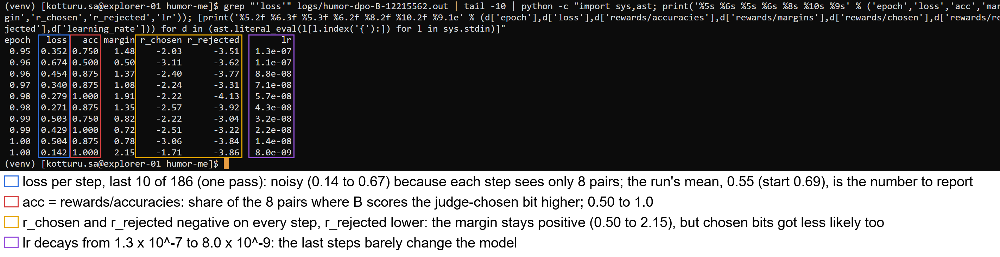
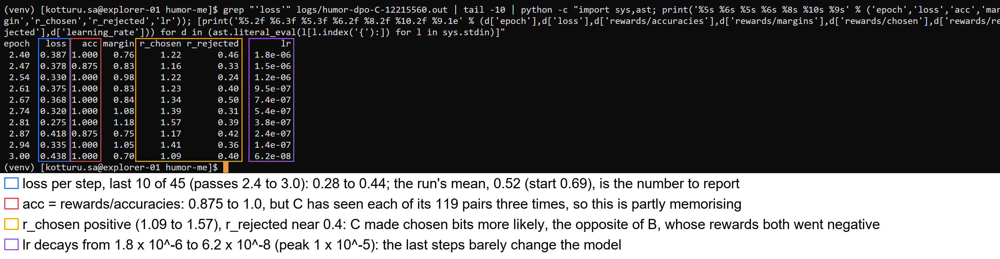

# Training the writer: SFT and DPO

**Where it fits:** the model track. The writer that speaks in the demo is a local model; this page is how we try to make it funnier by training it, and how we find out whether that worked.
**Used in:** `sim/dpo_pairs.py`, `sim/dpo_train.py`, `sim/dpo_eval.py`, the jobs in `explorer/`, decisions D-102, D-121 to D-124, Exp 36 to 38 in the [model notebook](../../notebooks/decisions-model.ipynb).

## The idea

A language model can be pushed toward what people prefer in two steps.

1. **SFT (supervised fine-tuning).** Show it good answers and it imitates them. We use the bit a judge liked most for each request.
2. **DPO (direct preference optimization).** Show it pairs of answers to one request, one preferred and one not, and it learns to make the preferred kind more likely, without a separate reward model. The model is measured against a frozen copy of itself, so it cannot drift far.

Both change a small add-on (**LoRA**), not the whole model, so a 4-billion-parameter model trains on one V100.

## Who says "funnier"?

DPO needs thousands of pairs. One person cannot rank that many (ranking 120 took the user 12 to 16 hours), so an AI judge was meant to label them, after proving it agrees with the user. Claude Haiku did not (24 of 46 pairs, Exp 36) and neither did Claude Opus (25 of 53, Exp 37): both are close to a coin flip against the user, and they agree with each other far more often than with the user.

The project trains anyway (D-123) and says plainly what each model is:

| Writer | Trained toward | Pairs |
|---|---|---|
| **A** | Nothing: the base model | none |
| **B** | **An AI judge's taste** (Haiku), not the audience's | about 1,200 to 1,850 pairs the judge labelled the same way in both orders |
| **C** | The user's own choices | the 120 pairs the user ranked (off-policy: they are another model's bits) |

Training toward a judge's taste is called **RLAIF**. It can go wrong in a quiet way: the model learns what the judge likes, including its quirks, and gets better at that while getting no better, or worse, for a real room. So the judge cannot grade B (it wrote B's labels), and the real test is the user's blind votes.

## The test (Exp 38)

Sixty new prompts, one bit from each writer for each. The user votes blind on 30 pairs (15 B against A, 15 C against A). The number of wins that counts as "funnier" is fixed by the user before the first vote; the proposal is 10 of 15, which a coin flip reaches 15% of the time. Your votes are noisy (you repeat a pick 60% of the time), so a real gain shows up smaller than it is. Fifteen pairs cannot see a small gain, so "not met" means "not shown". Opus judges every pairing too, and the report shows it beside the votes, never in place of them. A writer also has to be fast enough: its slowest 5% of bits within the 12 s budget, and almost none of its calls (at most 5%) cut off by that budget.

## Which model

All three start from `qwen3:4b-instruct` (D-124). The model the show uses today, bonsai-2:4b, is published only as packed ternary weights and needs a newer library than the university's GPUs can run, so it cannot be trained there. Qwen3 can, and it converts back to the format Ollama uses.

## Pieces

| Step | Where | What |
|---|---|---|
| Write the training bits | laptop | `sim.dpo_pairs write --split train --writer qwen3:4b-instruct` |
| Label | laptop, Claude Haiku | `sim.dpo_pairs label`: every pair in both orders; a pair the two orders split gets no label |
| Export | laptop | `sim.dpo_pairs export`: the files Explorer trains on, plus 60 held-out prompts |
| Train | Explorer | `explorer/smoke.sbatch` first, then `sft_B`, `dpo_B`, `dpo_C` |
| Convert | Explorer, CPU | `explorer/merge_gguf.sbatch` merges the add-on and makes a 2.5 GB file |
| Serve and test | laptop | `ollama create`, `sim.dpo_pairs eval ...` |

## One detail worth knowing

The model sees its prompt as text in a fixed layout (a chat template). Ollama's layout for this model has a blank line after the system text that the Hugging Face one does not. The writer's bits and the live show both go through Ollama, so training uses Ollama's layout; a test compares it with what the real template renders.

## Reading a training run (writer B's SFT)

SFT on 728 judge-chosen threads, 2 passes, 16 minutes: loss 0.96 to 0.51, tokens predicted right 76% to about 81%, and entropy 0.98 to 0.54. Lower entropy means more confident, less varied word choices, the usual cost of SFT; check B's bits for repetition. SFT's learning rate peaks 10 times higher than DPO's: 1 × 10⁻⁴ (0.0001) after a warm-up of about 9 of 182 steps, decaying to 7.5 × 10⁻⁸ by the end. [Annotated log](../../reports/figures/dpo/sft-B-training-log.png).

## Reading a training run (writer B's DPO)

DPO's loss starts at 0.693 (ln 2, a coin flip): at step 0 the trained model equals its frozen reference copy, so it has no preference yet. B's DPO runs on top of its SFT copy: one pass over the pairs, 186 steps, 22 minutes of training (32 for the whole job). The estimate was 3 to 6 hours.

- Loss 0.69 to 0.55 on average, and 0.14 at the last step. Reward accuracy ends between 0.75 and 1.0.
- The learning rate warms up, peaks, then decays almost to zero: 0 at step 1, a peak of 1 × 10⁻⁵ (0.00001) after about 19 steps, and 8.0 × 10⁻⁹ at the end.
- The fp16 scaler skipped steps 5 and 36 (`grad_norm` nan, loss fine). That is normal; training went on.
- **Both rewards fall.** B makes both bits less likely than its SFT copy, the rejected one much more. DPO only rewards the gap, so this still counts as learning, but if it goes too far the writing gets worse. Writer B's eval bits (step 13) and the vote will show it. C, below, behaves the other way.
- Peak GPU memory 8.8 GiB of 32.

Annotated logs: [start of training](../../reports/figures/dpo/dpo-B-training-start.png), [end of training](../../reports/figures/dpo/dpo-B-training-log.png).

## Reading a training run (writer C)

Writer C (DPO on 119 human-ranked pairs, 3 passes) ended at 0.52 and preferred the human-chosen bit on almost every training pair, which with so few pairs means memorising; only blind votes on new prompts show whether it generalises.

The learning rate has the same shape as B's, so the last steps barely change the model:

| Where | Learning rate | Plain decimal | Share of the peak |
|---|---|---|---|
| Step 1 | 0 | 0 | warm-up, no update yet |
| Step 2 | 2 × 10⁻⁶ | 0.000002 | 20% |
| Peak | 1 × 10⁻⁵ | 0.00001 | 100% |
| Third-last step | 2.4 × 10⁻⁷ | 0.00000024 | 2.4% |
| Last step | 6.2 × 10⁻⁸ | 0.000000062 | about 0.6% |

Compare with B's table above: B's chosen reward falls, C's rises.

Annotated logs: [start of training](../../reports/figures/dpo/dpo-C-training-start.png), [end of training](../../reports/figures/dpo/dpo-C-training-log.png).

## Both writers' files

Job results: [sacct](../../reports/figures/dpo/dpo-B-sacct.png). The two GGUF files have different hashes, so B and C are different models: [hashes](../../reports/figures/dpo/gguf-hashes.png).

## Going deeper

- [Direct Preference Optimization](https://arxiv.org/abs/2305.18290) (Rafailov et al., 2023): the method.
- [LoRA](https://arxiv.org/abs/2106.09685) (Hu et al., 2021): the small add-on.
- [TRL's DPOTrainer](https://huggingface.co/docs/trl/dpo_trainer): the library we use.
- Why the judge failed and what we did about it: [metrics.md](../metrics.md) (Exp 36 and 37), [decisions.md](../decisions.md) (D-121 to D-124).
