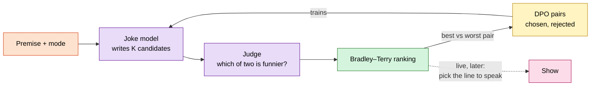

# The judge and the joke model: what each one does

Where this fits: the model track in [docs/status.md](../docs/status.md) ("own premises → 6-mode candidates → judge →
SFT → DPO"). The step-by-step build is [docs/plans/DPO_training.md](../docs/plans/DPO_training.md). The **joke model**
is the generator that SFT and DPO train. "Policy" is reserved for the director's rule ([glossary](../docs/wiki/glossary.md)).

## In one picture

**Summary:** the director picks the mode, the joke model writes lines, the judge ranks them, and the best-vs-worst
pairs train the joke model.

| | Judge | Joke model |
|---|---|---|
| Job | Picks the funnier of two jokes | Writes one line for a premise in a given mode |
| Output | `0` (first) or `1` (second) | One speech-sized line |
| Model | `llama3.1:8b` in the first test; final choice by Exp 17 | `Qwen/Qwen2.5-7B-Instruct` + LoRA |
| Trained? | No, prompted | Yes: SFT, then DPO |
| Code | `judge/` | `explorer/train_dpo.py` |

## The judge

**Summary:** many pairwise "which is funnier?" answers become a ranking through Bradley–Terry. The pipeline works,
but the judge itself is not yet validated against people.

**How a ranking is made** (`judge/rank.py` `rank()`):

1. **Choose pairs:** all pairs, n(n−1)/2 calls, or adaptive LUCB, which only asks pairs whose order is still in doubt.
2. **Randomize order:** a recorded coin flip picks which joke is shown first, to measure position bias.
3. **Fit Bradley–Terry:** P(i beats j) = σ(θᵢ − θⱼ), with a prior of α virtual games so θ stays finite. Standard
   errors come with the fit.
4. **Sort by θ** and log every comparison (`write_judgments`).

Derivations: [judge/README.md](README.md), [docs/wiki/Bradley-Terry.md](../docs/wiki/Bradley-Terry.md).

**First test** (`judge/result.md`): 8 jokes, 28 calls to `llama3.1:8b`.

- The two flat jokes ("Cat.", "Cats are animals.") ranked last, which is sensible.
- Three jokes tied at the top and three at the bottom, with SE ≈ 1: one comparison per pair cannot separate them.
- The joke shown first won 12/28 (p = 0.57), so no position bias was detected at this size.
- This tests the **pipeline**, not the judge's taste.

**Uses:** offline, rank K = 4 candidates per (premise, mode) and keep the best-vs-worst pair only if the judge agrees
in both orders. Live, later, pick the best candidate, but only after validation. Until then, live picks are uniform
and logged (decisions.md 2026-11-08).

**Gate before labeling** (DPO_training.md step 3): test plain, "human taste" and few-shot prompts on 1,500 matched
rJokes pairs, in both orders. The best judge's 95% CI on agreement with upvotes must sit above 0.5. If none clears it,
stop, and SFT alone is the fallback.

**State:** `rank()`, Bradley–Terry, standard errors, LUCB, the simulated judge and the Ollama smoke test are done.
`LLMJudge.compare` and Exp 17 are not. The code is on the `judge-api` branch, not `main`.

## The joke model

**Summary:** Qwen2.5-7B learns the judge's taste in two steps: SFT on the top candidates, then DPO on judged pairs.
The DPO script is written but hasn't been run.

**Pipeline:** about 1,000 own premises × 6 modes × K = 4 candidates (temperature ≈ 0.9–1.0) → safety filter (a
failing line can never be `chosen`) → judge → **SFT** on the top candidate (the fallback checkpoint) → **DPO** on
(chosen, rejected). No rJokes or transcript text is used as material.

**DPO script** (`explorer/train_dpo.py`): TRL `DPOTrainer`, LoRA r = 16, α = 32, and the base with the adapter off as
the reference. β = 0.1, lr 2e-5 with cosine schedule, 1 epoch, 32 pairs per update, max length 512, checkpoints every
100 steps. It reads the **first** 20k train and 2k dev rows, not a random sample.

**Evaluation** (DPO_training.md step 10): a power-sized **human vote** on held-out premises decides: DPO vs SFT vs
base. The judge's win rate, length, safety pass rate and per-mode results are secondary.

**State:** the DPO script is written. `trl`/`peft` in the requirements, premises, candidate generation, the pair
builder and `train_sft.py` are not.

## How they can fail together

**Summary:** DPO copies the judge, so any flaw in the judge becomes a flaw in the model.

- **Learning the judge, not people:** an LLM judge and upvotes agree only partly (Exp 10: Spearman ρ +0.20 to +0.37).
  Hence Exp 17 first, and a human vote at the end.
- **Length gaming:** if the judge favours longer jokes, DPO teaches rambling. Compare chosen/rejected word counts
  before training.
- **Position bias:** blocked by the coin flip plus the two-order consistency check.

## Open points to check

- **What `train_dpo.py` trains:** the plan trains the joke model from the SFT checkpoint. The script starts from the
  base, is named `dpo_judge`, and filters "long joke pairs", which suggests it trains a **judge** on rJokes pairs.
  If so, that's a new design: it needs a decisions.md entry and a held-out upvote-agreement evaluation, and rJokes
  text must not become joke material.
- **Hardware:** the job asks for an H200 in bf16. The plan assumed a V100 in fp16. Record the partition actually used
  in `explorer/README.md`.